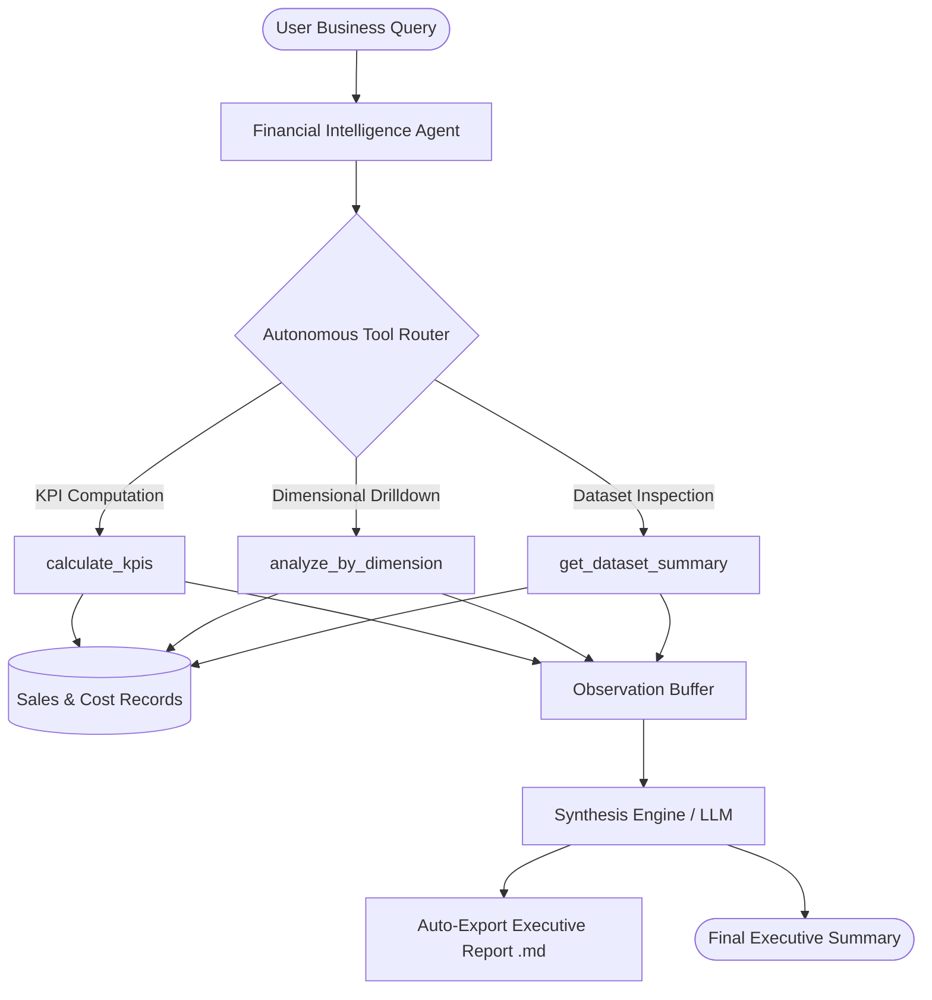

# Autonomous Financial & Business Intelligence Agent 🤖📊

[](https://www.python.org/)
[](https://pandas.pydata.org/)
[](#architecture)
[](https://iitmpravartak.org.in/)

An autonomous multi-tool **Agentic AI system** designed to automate business intelligence, financial performance audits, KPI tracking, and variance analysis. 

The agent accepts natural language business inquiries, autonomously reasons over required analytical tools, queries underlying financial data, computes margins, and generates structured executive reports.

---

## 🏗️ System Architecture

The agent follows the **ReAct (Reason + Act)** and **Tool-Calling** design pattern:



---

## 💡 Key Capabilities

- **Autonomous Tool Selection**: Dispatches analytical tools dynamically based on user intent (e.g., product margin inspection, regional sales, company-wide KPIs).
- **Financial Metric Computation**: Real-time evaluation of Revenue, Cost of Goods Sold (COGS), Gross Profit, and Profit Margins (%).
- **Variance & Anomaly Detection**: Highlights high-margin product opportunities and territory imbalances.
- **Automated Report Generation**: Exports comprehensive, C-level executive summaries to `/reports` in Markdown format.
- **Dual-Engine Architecture**:
  - **LLM Mode**: Integrates with Google Gemini API for deep natural language synthesis.
  - **Deterministic Engine**: Runs fully offline with built-in analytical rules if no API key is supplied.

---

## 📁 Project Structure

```text
autonomous-financial-agent/
│
├── data/
│   └── sales_records.csv       # Multi-product enterprise sales & cost dataset
├── reports/
│   └── executive_financial_report.md  # Auto-generated executive report
├── agent.py                    # Core Agent logic & ReAct reasoning loop
├── tools.py                    # Tool definitions (KPIs, dimensional analysis, export)
├── main.py                     # CLI entry point and demonstration runner
├── requirements.txt            # Project dependencies
├── .env.example                # Configuration template
└── README.md                   # Project documentation
```

---

## 🚀 Quickstart Guide

### 1. Clone the Repository
```bash
git clone https://github.com/manjesh694/autonomous-financial-agent.git
cd autonomous-financial-agent
```

### 2. Install Dependencies
```bash
pip install -r requirements.txt
```

### 3. (Optional) Configure LLM API Key
Copy `.env.example` to `.env` and add your Gemini API Key:
```bash
cp .env.example .env
```
*(Note: If no API key is provided, the agent automatically executes in standalone deterministic mode.)*

### 4. Run the Agent
```bash
python main.py
```

---

## 📊 Sample Agent Output

```text
[Agent] Received User Objective: "Give me an executive overview of total revenue, KPIs, and product performance. Export a report."
[Agent Action] Calling Tool: calculate_kpis()
[Agent Action] Calling Tool: analyze_by_dimension('Product_Name')
[Agent Action] Report successfully saved to: reports/executive_financial_report.md

=================================================================
 AGENT RESPONSE:
=================================================================
## Executive Financial Analysis & Insights
- Total Revenue: $76,125.00
- Total Cost: $44,465.00
- Gross Profit: $31,660.00
- Overall Profit Margin: 41.59%
- Top Revenue Product: Enterprise Laptop ($31,200)

Product Breakdown:
- Enterprise Laptop:    Revenue: $31,200 | Margin: 29.17%
- Data Security Suite:  Revenue: $17,500 | Margin: 60.00%
- UltraWide Monitor:    Revenue: $11,700 | Margin: 31.11%
- Cloud Server License: Revenue: $10,500 | Margin: 57.14%
```

---

## 👨‍💻 Author
**Manjesh**  
- **LinkedIn**: [linkedin.com/in/manjesh-g](https://linkedin.com/in/manjesh-g)  
- **GitHub**: [github.com/manjesh694](https://github.com/manjesh694)  
- **Certification**: Advanced Certification in Agentic AI Systems Design – IITM Pravartak  
